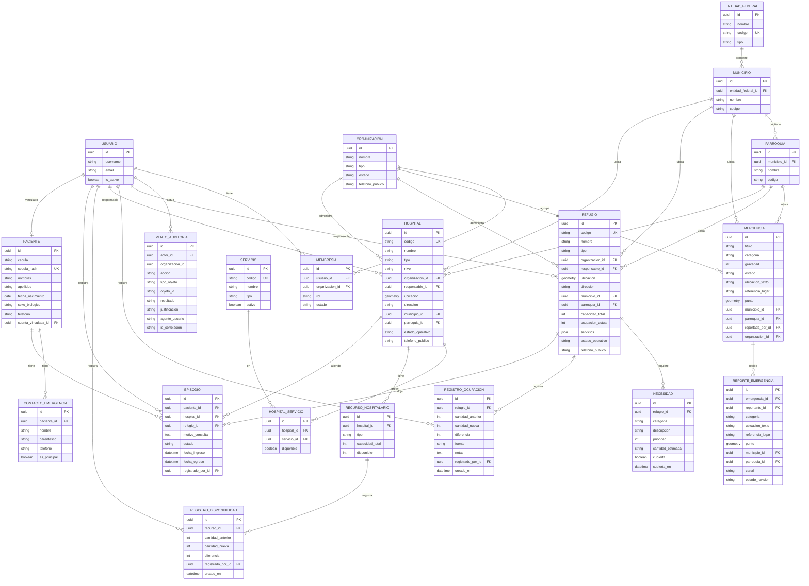

# Modelo Entidad-Relación — IntegraVida

> **Estado:** parcial — cubre las 5 entidades implementadas (Fase 1 retroactiva).
> Las apps restantes se marcan como TBD y se documentarán al inicio de su fase.

## Diagrama

## Entidades pendientes por fase

| App | Fase del prompt §24 | Dependencias |
|---|---|---|
| `refugios` | **✅ Fase 5 — implementado** | — |
| `hospitales` | **Fase 6.1 — implementado** | — |
| `pacientes` | **Fase 6.2 — implementado** | — |
| `triaje` | Fase 6 | pacientes |
| `derivaciones` | Fase 7 | hospitales |
| `inventario` | Fase 8 | organizaciones |
| `distribucion` | Fase 8 | inventario |
| `configuracion` | Fase 9 | — |
| `reportes` | Fase 9 | transversal |

## Clasificación por sensibilidad (§6.2)

| Entidad | Clasificación predominante |
|---|---|
| EntidadFederal, Municipio, Parroquia | PUB |
| Organizacion | PUB (institucional) |
| Usuario | PER (con campos SEC) |
| Membresia | OPE / PER |
| Emergencia | OPE (con campos públicos autorizados) |
| ReporteEmergencia | OPE / PER |
| EventoAuditoria | AUD |

## Pendiente de diseño antes de Fase 3

- Añadir a `EventoAuditoria`: `fecha_hora` (TIMESTAMPTZ), `ip_origen`, `hash_anterior`, `hash_actual`.
- Evaluar convertir `EventoAuditoria.organizacion_id` (UUIDField) en `ForeignKey(Organizacion, null=True, on_delete=PROTECT)`.
- Definir `UniqueConstraint` en `Membresia(usuario, organizacion, rol)`.
- Definir `UniqueConstraint` en `Municipio(entidad_federal, codigo)` y `Parroquia(municipio, codigo)`.
